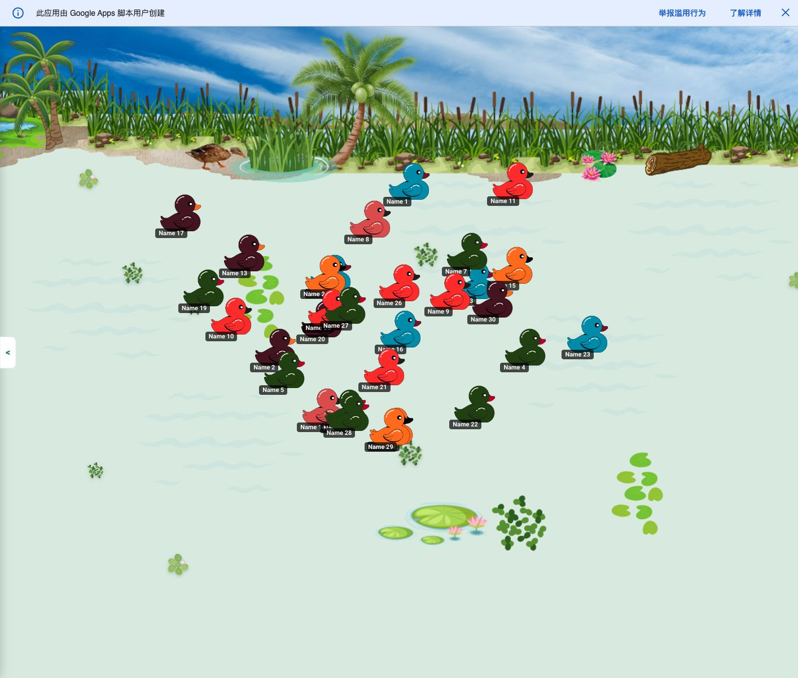

# 鸭子＋障碍自动竞速：市场补充研究

日期：2026-10-21。研究对象是“输入名单后，鸭子自行通过障碍，观众观看名次变化”的网页工具；不是操控鸭子躲障碍的动作游戏。东南亚重点为菲律宾、越南和印尼，美国仅作参照。

## 结论与本轮修正

值得继续做小原型，但现有证据支持的是**已有随机点名市场中的体验差异化**，还不支持“障碍鸭赛是独立搜索蓝海”。

1. “鸭子＋障碍”已有实现：DuckPark.io（操控游戏）、开源 2D 河道物理鸭赛、Twitch 桌面鸭赛，以及 Outing 的活动抽签产品。不能把组合本身当作独有功能。
2. 东南亚更明确的搜索需求仍是名字选择、课堂和免费网页使用。菲律宾英语适合当前中英文首版；新发现越南“đua vịt chọn tên”（鸭子竞速选名字）约 3,600/月，值得后续本地语言验证。
3. 最可验证的价值是：**鸭子以相同推进规则穿过可读障碍，碰撞、堵塞和分流实际影响名次；用户能看懂为什么被反超。**这是一项待验证的产品假设。
4. 没有证据证明用户会为了“更真实的物理”迁移、付费或主动分享；复杂障碍还会提高卡死、加载和手机性能风险。

## 方法与费用边界

- 复用小游戏雷达 UI 中 RandomDuckRace 快照 #5（47 个美国英语排名词，首页 ETV 728.408/月，2 个排名页面）。该记录不能当东南亚域名流量。
- OpenSEO 补查 19 个概念词×4 市场（76 组合），返回 20 条指标记录；对菲律宾/印尼 duck race、越南 đua vịt 各做一轮关键词扩展，共返回 435 行，包含大量无关鸭子品种、食物等词，已排除其对结论的影响。
- 核验 6 组移动端 SERP（depth 10 含 App/视频/AIO 等元素），检查官方产品页、开源仓库和用户反馈，浏览器实玩 Outing 免费示例一轮。
- 新增付费能力调用共 4 次指标、1 次三种子扩展、1 次六词 SERP；工具未返回本轮实际 USD/积分，因此开销未知，不记为零。没有购买套餐、开通订阅或修改项目预算。
- 没有自行调用供应商 HTTP 接口。本轮区域词用已连接 OpenSEO 工具查询；没有为了迁就原生美国项目修改其市场。
- 原始数据：[指标、扩展与 SERP 证据](2026-10-21-duck-obstacle-market-evidence.json)。

## 竞争结构

| 产品 | 类型与已有能力 | 与本方案重叠 | 证据边界 |
|---|---|---|---|
| [RandomDuckRace](https://randomduckrace.com/changelog/) | 浏览器 3D 名字选择、课堂、房间；更新日志称 10/12 上线急流，10/18 移除急流，以水流和尾流决定比赛 | 命名鸭子、自动观赛、3D，与本方案直接竞争 | 官方日志；未审查其物理实现。日志没有说明移除急流的具体原因 |
| [Outing](https://outing.vn/dua-vit/) | 越南活动抽签；官网宣传越障碍与 3D，支持名单、时长和多名获胜者 | 最直接的“名单＋鸭子＋障碍＋活动”产品定位重叠 | 免费版完成一轮；呈现为平面侧视卡通鸭和水草等元素，不能据此确认 Pro 真 3D 或障碍真实碰撞 |
| [DuckPark.io / CrazyGames](https://www.crazygames.com/game/duckpark-io) | 操控鸭子在滑道上移动、碰撞、跳跃、抄近路；发行页评分 8.8，72K 赞/9.7K 踩（页面可变） | 证明鸭子、路线、可见碰撞可以组成观赏性玩法 | 发行平台公开指标不是人数、DAU、东南亚用户或收入；与自动点名用途不同 |
| [inemtsev/duck-race](https://github.com/inemtsev/duck-race) | 开源 2D 河道模拟，README 列出石头/浮木、漩涡、碰撞、种子、终点回放 | 障碍推动名次变化已经出现 | 仓库说明，不是采用率；页面显示 0 star/0 fork，不能证明市场验证或竞品普遍抄它 |
| [Ibzy Duck Race](https://store.steampowered.com/app/2152420/Duck_Race/) | 桌面/Twitch 观众入场自动竞速，商店描述有多条河道和瀑布 | 自动观赛、社区互动与复杂环境重叠 | Steam 页面 10 条评测、90% 好评，小样本且不是东南亚销量；商店部分早期访问说明可能过时 |
| [HorseRacePicker 鸭赛](https://horseracepicker.com/duck-race) | 先抽完整顺序，再动画展示；明确披露机制 | 同一名字选择任务的替代品 | 不是障碍物理模拟；说明公平抽签与真实物理是不同产品承诺 |

## 对 RandomDuckRace 的新认识

官方 [Changelog](https://randomduckrace.com/changelog/) 记录：
- 2026-10-12：v2.0 宣称真 3D 河道包含水流、急流与尾流。
- 2026-10-18：明确写移除急流，保留水流、尾流影响比赛。
- 近几天持续记录手机、低端 Chromebook、加载与帧率优化。

这与用户观察到的较直线赛道相容。不能推断“它没想到障碍”，也不能断言“它因性能移除了急流”；日志只确认改动，未解释该因果。对本原型的启示是同时验证障碍可读性与性能，而不是只比场景复杂度。该站仍在快速迭代，市场差异化可能很快缩小。

## Outing 免费版实玩

从官网嵌入的公开 Google Apps Script 试玩页进入，用自带示例生成 30 个 Name 条目，默认显示 45 秒，启动后观察移动和结果，最终显示 Name 23。

- 确认能配置名单、比赛时长、Top 名额并展示获胜者。
- 可见画面是平面卡通鸭、河岸、水草、终点及结果弹窗，不能确认是真 3D；水草出现不等于已证实其碰撞决定名次。
- 本轮未购买或测试 Pro，也未验证随机性、内部排序算法、手机性能和完整比赛时间准确性。
- 官网当前报价：Free 至多 60 人；Pro 110,000 VND/PIN，宣传至多 800 鸭、品牌定制和 Excel 结果导出，激活后 48 小时有效。这是供给端定价证据，不是付费人数或收入。

## 搜索需求：要承接什么

供应商国家/语言配置估算，近义词和主题词不能作为独立用户相加。KD 为供应商难度指标，0 不等于无竞争。

| 市场 | 词与含义 | 月搜索量 | KD | 与产品的匹配 |
|---|---|---:|---:|---|
| 菲律宾 / en | duck race name picker | 1,300 | 2 | 主入口，上一轮已有数据 |
| 菲律宾 / en | duck race randomizer | 2,400 | 0 | 明确随机选择，需兼顾规则说明 |
| 菲律宾 / en | duck race simulator | 390 | 1 | 混合 App、动作游戏和课堂工具 |
| 菲律宾 / en | duck race game | 3,600 | 10 | 泛词，不可全部归因点名器 |
| 菲律宾 / en | duck race recitation | 40 | unknown | 小但场景直接，来自扩展结果 |
| 越南 / vi | đua vịt chọn tên：鸭子竞速选名字 | 3,600 | 1 | 比上一轮误用的越南语组合更明确，应作为新增发现 |
| 越南 / vi | đua vịt random：随机鸭赛 | 2,400 | 2 | 随机工具类 |
| 越南 / vi | trò chơi đua vịt trả bài：课堂抽查鸭赛 | 880 | 0 | 场景明确，不等于独立新增用户 |
| 越南 / vi | trò chơi đua vịt gọi tên học sinh：叫学生名字鸭赛 | 170 | unknown | 课堂长尾 |
| 印尼 / id | duck race name picker | 480 | 8 | 英语词，上一轮已有数据 |
| 印尼 / id | duck race gratis：免费鸭赛 | 170 | 5 | 免费意图，与 App/动作游戏混合 |
| 印尼 / id | online duck race game | 260 | 11 | 可玩网页意图，但玩法混合 |
| 美国 / en | duckpark io | 260 | 0 | 现有游戏品牌，不作为我们的目标词 |
| 美国 / en | duck race with names | 40 | 0 | 场景相关，非本轮主要市场 |

本轮查的 duck race obstacles、duck race obstacle course、duck race simulator obstacles、3d duck race、duck race track builder、duck race maker、duck race physics、duck race custom track、duck race elimination 等均未返回记录。**含义是没有拿到可用量化数据，不是搜索量为零，也不是没人喜欢这类玩法。**

菲律宾 duck race obstacles 的移动结果主要混入真实活动、图库、Pinterest 和其他 App；没有呈现稳定的自动障碍观赛工具意图。不能以“没几个竞品站”反推蓝海。

### SERP 给出的实际渠道判断

- 菲律宾 duck race game：同时出现线下鸭赛教程、DuckPark、Duck Life、名字选择器、Twitch 游戏；大词分流明显。
- 越南 đua vịt chọn tên：教程零售站、App 和课堂工具都有；“trò chơi đua vịt trả bài”出现教师视频与 tuduy.com 的实际点名网页。说明应提供可直接开赛的产品，而不是只写泛教程。
- 印尼 duck race gratis：混合教育社媒、Duck Life、App 和名字工具；免费、无需下载、直接输入名字是更合适的承接信息。

## 用户反馈：支持什么、不支持什么

[Ibzy 作者发布页](https://ibzy.itch.io/duck-race) 上一名玩家曾报告直播帧率低（15–40 FPS）和鸭子卡在地图；开发者回复承认部分区域无水流，会形成未完赛。这是具体的性能/卡死问题信号，但来自数年前一个桌面作品的一条反馈，不能作为当前网页用户总体比例。

[Duck Race: Name Picker 的 App Store 页面](https://apps.apple.com/us/app/duck-race-name-picker/id6466559764) 的样本评论提到名单顺序、姓名显示与自定义外观；部分历史评论自述为解锁人数付费。它们提示界面可读性与列表可靠性有价值，但不证明当前价格、销量或用户愿意为障碍付费。

本轮找到的直接“鸭赛无聊、想要带名字的迷宫/障碍弹珠替代”线索来自一条 2022 年 Reddit 搜索摘要（[原帖](https://www.reddit.com/r/tipofmytongue/comments/zfxj2o/)）；全文读取失败，因此只保留为弱线索，不当主要需求证据。没有发现足以代表东南亚用户的“我要复杂障碍鸭赛”的调查或规模化反馈。

## 可尝试的产品定位与获客路径

推荐描述：**名字变成鸭子，穿过真实影响结果的障碍，看看谁能先到终点。**避免宣传“最公平”“唯一 3D”“首个障碍鸭赛”。

| 路径 | 为什么可能有效 | 当前缺口 | 下一步 |
|---|---|---|---|
| 菲律宾英语点名入口 | 有明确工具词，当前中英文可服务 | 未证明比现有工具更快或更愿意再用 | 和现有工具做相同名单任务对比 |
| 越南课堂入口 | 本地选名字/课堂词更明确，有现成网页场景 | 中文英文不足以完整承接；竞争不空白 | 先请母语用户验证价值，再决定是否扩语言 |
| 短视频/群聊观赛 | 一次可见碰撞与反超容易演示 | 没有实际分享数据，不能假设自动爆款 | 手工录 10–20 秒真实原型反超片段，不先开发导出器 |
| 活动主持/会议 | Outing 有公开按场次定价，显示供应商愿意卖 | 没有本产品付费验证 | 后续再测去品牌/大屏等需求，不阻塞免费原型 |
| 游戏门户 | DuckPark 证明鸭子竞速有发行空间 | 自动点名器与操控游戏不同，可能不匹配门户要求 | 单独验证发行意愿，不按同一产品预估收入 |

## 原型验证与停止条件

先做 12 鸭、一个赛道、三个障碍模块，默认单人发起、多人观看。允许在起跑前有随机初始位置和相位，但开赛后不通过隐藏排名修正系数制造追逐；救援必须统一规则且可见。

第一轮招募 10 名符合课堂/主持/朋友互动场景的人，与现有鸭赛工具完成同一任务，顺序交替，使用相同名单。建议预注册实验门槛（不是行业标准）：
- 至少 7 人能说清一次反超/减速发生的原因；
- 至少 6 人在同样任务下更愿意再用障碍版本，并写明原因；
- 至少 3 人在 7 天内主动再次使用或分享；
- 无需指导完成名单→开赛；记录用时，而非先承诺一定更快。

工程检查：在固定模型与视角下多种种子批量跑，统计完赛、卡死/救援、名次变化与时长分布；按起点统计胜率偏差；桌面和真实低端 Android 单独验收。首轮可设无救援完赛率至少 95% 的内部门槛，不把这个原型门槛当成正式上线标准。

如果障碍版本让人看不清、等待更久或频繁卡死，应先减少障碍/改镜头，不继续堆赛道编辑器、皮肤与多人房间。如果大家只需要快速选人，应调整定位或保留轻量模式；不要用物理复杂度替代用户价值。

## 仍未知

- 东南亚各国家的 RandomDuckRace 域名排名与跨渠道流量；
- Outing Pro 的真实画面、碰撞机制及付费人数；
- 玩家是否愿意为了可见障碍迁移、分享、回访或付费；
- 手机性能、名单隐私验收、统计公平性与跨设备回放一致性；
- 广告 RPM、可获点击量和回本。关键词 CPC 不等于发布商广告收益。

研究支持现在做原型并验证体验，不支持据此直接购买流量或预测收入。

